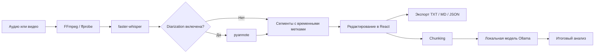

<div align="center">

# Local Transcript AI

### Локальная транскрибация аудио и видео с анализом через локальную LLM

`faster-whisper` превращает запись в редактируемый текст, `pyannote` при необходимости разделяет спикеров, а Ollama помогает разобрать результат — без передачи исходного медиа в LLM.


</div>

## Зачем я сделал этот проект

Мне нужен был инструмент, который может работать с длинными записями локально: показать ход обработки, сохранить временные метки, дать исправить текст и только после этого отправить подготовленную транскрипцию в локальную языковую модель.

В результате получился не отдельный ML-скрипт, а небольшое full-stack приложение — от проверки видео через FFmpeg и фоновых заданий в Python до интерфейса на React.

## Что уже работает

| Возможность | Реализация |
|---|---|
| Транскрибация | `faster-whisper`, выбор модели, языка и CPU/CUDA |
| Медиа | MP3, WAV, M4A, AAC, FLAC, OGG, MP4, WEBM, MOV и MKV |
| Длинные задания | Фоновая обработка, прогресс, время выполнения и отмена |
| Спикеры | Опциональная diarization через `pyannote`, ручное переименование |
| Редактирование | Правка текста, поиск, копирование и работа с сегментами |
| Экспорт | TXT, Markdown и JSON |
| AI-анализ | Готовые сценарии и свободные вопросы через локальный Ollama |
| Большой контекст | Разбиение транскрипции на части и финальная агрегация |
| Интерфейс | React + TypeScript, адаптивная вёрстка, светлая и тёмная темы |
| Надёжность | Проверка FFmpeg, Ollama, CUDA, моделей и ошибок памяти |

## Мой вклад

Проект реализован мной самостоятельно. Я собрал в одной системе несколько разных уровней разработки:

- **ML и обработка речи:** подключение Whisper, выбор compute-режима, diarization и сборка итоговых сегментов;
- **локальные LLM:** интеграция с Ollama, сценарии анализа, chunking и агрегация длинного текста;
- **backend:** FastAPI, контракты API, фоновые задания, отмена и локальное хранение результатов;
- **frontend:** React/TypeScript-интерфейс, настройки, прогресс, уведомления и редактирование транскрипции;
- **работа с медиа:** проверка форматов и метаданных через FFmpeg/ffprobe;
- **инженерная часть:** разделение сервисов, обработка ошибок и автоматические тесты основных сценариев.

## Как проходит обработка



Исходное медиа используется Whisper и, при включении, pyannote. В Ollama передаётся только сформированный текст с временными метками и именами спикеров.

## Структура

```text
local-transcript-ai/
├── backend/
│   ├── app/main.py              # FastAPI и HTTP endpoints
│   ├── app/prompts.py           # сценарии анализа
│   ├── app/services/
│   │   ├── transcription.py     # faster-whisper
│   │   ├── diarization.py       # разделение спикеров
│   │   ├── ollama.py            # локальный LLM-анализ
│   │   ├── jobs.py              # фоновые задания
│   │   ├── media.py             # FFmpeg / ffprobe
│   │   └── storage.py           # локальное хранение
│   └── tests/
├── frontend/
│   └── src/                     # React + TypeScript
└── start.ps1                    # общий запуск в Windows
```

## Быстрый запуск

### Требования

- Python 3.10–3.12;
- Node.js 20+;
- FFmpeg и ffprobe в `PATH`;
- Ollama — только для AI-анализа;
- CUDA — опционально, транскрибация работает и на CPU.

### Windows

```powershell
.\start.ps1
```

После запуска интерфейс будет доступен по адресу `http://localhost:5173`.

### Ручной запуск backend

```powershell
Set-Location .\backend
python -m venv .venv
.\.venv\Scripts\Activate.ps1
python -m pip install --upgrade pip
python -m pip install -r requirements.txt
uvicorn app.main:app --reload --host 127.0.0.1 --port 8000
```

### Ручной запуск frontend

В отдельном терминале:

```powershell
Set-Location .\frontend
npm ci
npm run dev
```

### Локальная модель

```powershell
ollama pull qwen3:8b
```

Модель можно заменить в настройках приложения. Для менее мощного компьютера подойдёт меньшая модель Ollama и Whisper `base` или `small`.

## Diarization

Зависимости для определения спикеров устанавливаются отдельно:

```powershell
Set-Location .\backend
python -m pip install -r requirements-diarization.txt
```

После принятия условий модели pyannote задайте `HF_TOKEN` в локальном `.env`. Пример конфигурации находится в `backend/.env.example`; реальные токены Git не отслеживает.

## Проверка проекта

Backend:

```powershell
Set-Location .\backend
python -m unittest discover -s tests -v
```

Frontend:

```powershell
Set-Location .\frontend
npm ci
npm run build
```

## Ограничения

- качество распознавания зависит от записи, языка и выбранной Whisper-модели;
- diarization требует отдельного доступа к модели pyannote и заметно увеличивает требования к ресурсам;
- большие модели требуют больше RAM или VRAM;
- при указании удалённого Ollama URL текст будет отправлен на этот сервер;
- приложение рассчитано прежде всего на локальный запуск, а не на открытый публичный сервер.

## Дальше

- улучшить работу с очень длинными записями;
- добавить более гибкое оформление экспорта;
- расширить тесты API и frontend;
- улучшить diarization для записей с шумом и перебиваниями;
- подготовить сборку, которую можно запускать без ручной настройки окружения.

---

<div align="center">

**Разработано самостоятельно: ML-пайплайн, backend, frontend и локальная AI-интеграция.**

Перед публикацией добавьте здесь своё имя и ссылку на GitHub-профиль.

</div>
